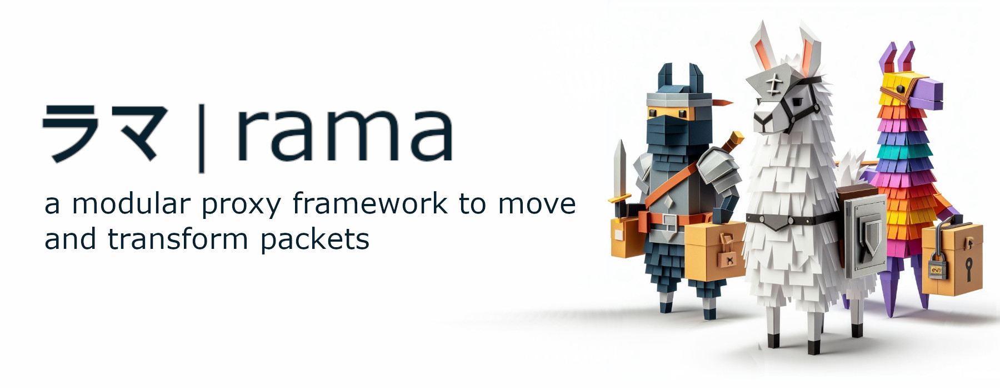
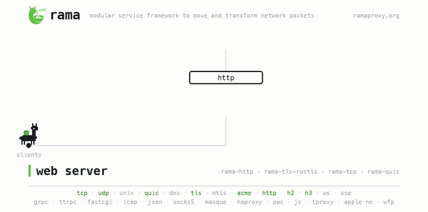
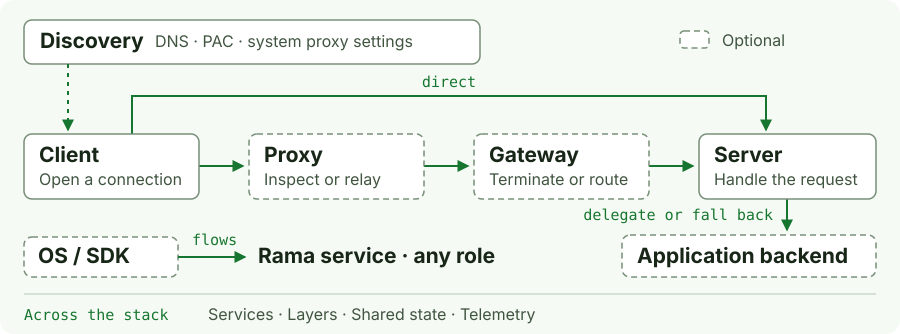

[![Crates.io][crates-badge]][crates-url]
[![Docs.rs][docs-badge]][docs-url]
[![MIT License][license-mit-badge]][license-mit-url]
[![Apache 2.0 License][license-apache-badge]][license-apache-url]
[![rust version][rust-version-badge]][rust-version-url]
[![Build Status][actions-badge]][actions-url]
[![Lines of Code][loc-badge]][loc-url]

[crates-badge]: https://img.shields.io/crates/v/rama.svg
[crates-url]: https://crates.io/crates/rama
[docs-badge]: https://img.shields.io/docsrs/rama/latest
[docs-url]: https://docs.rs/rama/latest/rama/index.html
[license-mit-badge]: https://img.shields.io/badge/license-MIT-blue.svg
[license-mit-url]: https://github.com/plabayo/rama/blob/main/LICENSE-MIT
[license-apache-badge]: https://img.shields.io/badge/license-APACHE-blue.svg
[license-apache-url]: https://github.com/plabayo/rama/blob/main/LICENSE-APACHE
[rust-version-badge]: https://img.shields.io/badge/rustc-1.96+-blue?style=flat-square&logo=rust
[rust-version-url]: https://www.rust-lang.org
[actions-badge]: https://github.com/plabayo/rama/actions/workflows/CI-status.yml/badge.svg?branch=main
[actions-url]: https://github.com/plabayo/rama/actions/workflows/CI.yml
[loc-badge]: https://img.shields.io/endpoint?url=https://ramaproxy.org/static/badges/loc.json
[loc-url]: https://github.com/plabayo/rama

[discord-badge]: https://img.shields.io/badge/Discord-%235865F2.svg?style=for-the-badge&logo=discord&logoColor=white
[discord-url]: https://discord.gg/29EetaSYCD
[bmac-badge]: https://img.shields.io/badge/Buy%20Me%20a%20Coffee-ffdd00?style=for-the-badge&logo=buy-me-a-coffee&logoColor=black
[bmac-url]: https://www.buymeacoffee.com/plabayo
[ghs-badge]: https://img.shields.io/badge/sponsor-30363D?style=for-the-badge&logo=GitHub-Sponsors&logoColor=#EA4AAA
[ghs-url]: https://github.com/sponsors/plabayo
[paypal-badge]: https://img.shields.io/badge/paypal-contribution?style=for-the-badge&color=blue
[paypal-url]: https://www.paypal.com/donate/?hosted_button_id=P3KCGT2ACBVFE

🦙 rama® (ラマ) is a modular service framework for the 🦀 Rust language
that provides a cohesive foundation for building network clients,
servers, proxies, and combinations thereof.

The framework is intentionally explicit. Your network stack is built from services,
layers, transports, protocols, and state that you compose yourself. That makes
the shape of the system visible in the code, instead of hidden behind framework
magic or configuration.

This makes Rama a good fit not only for proxies, but for network services where
the stack itself matters: how traffic enters, how it is decoded, where state
lives, what gets inspected, what gets transformed, and where it goes next.

Use it to inspect traffic for security analysis, write web services, emulate
clients with custom user agents, control connection behavior for testing, or
build high-performance proxies, all on a composable
[Tokio](https://tokio.rs/)-native foundation.

Rama is used in production for network security, data extraction, API gateways,
routing, and other networked systems.

> [!NOTE]
>
> This framework is developed and maintained by [Plabayo](https://plabayo.tech),
> a European software studio based in Gent, Belgium, focused on building resilient,
> interoperable, and secure digital infrastructure.

  <picture>
    <source
      media="(prefers-color-scheme: dark)"
      srcset="docs/img/rama-dark.gif">
    
  </picture>

## How the pieces fit together

Start with a service that does one job. Wrap it in a layer to add behavior, or
connect it to another service. The same model works across network layers and
protocols, so you can start with built-in pieces and add your own Rust code
where you need it.

The map and tables below give you an overview. To get a feel for building with
Rama, browse the [examples](./examples/README.md), run one close to what you
want to build, and make it your own. Try swapping a connector or writing a layer
in Rust.
The [Rama Book](https://ramaproxy.org/book/intro.html) explains how the pieces
compose, and the [edge API docs](https://ramaproxy.org/docs/rama) cover the code
you’re working with on `main`.

The [`rama` CLI](https://ramaproxy.org/book/deploy/rama-cli.html) lets you run ready-made stacks from the terminal.
Try `rama serve proxy --mitm` to start a proxy with a traffic inspection UI.
Alongside the examples, the [CLI source](./rama-cli/src/cmd/) shows how a full
application composes Rama services into clients, servers, proxies and diagnostic tools.

A client can connect straight to a server. Add a proxy, a gateway, or both when
traffic needs an intermediate hop. The server can answer on its own or delegate
some or all requests to an application backend.

An optional platform SDK gives your service another entry point. The OS can
redirect a flow into your stack before it reaches its original destination.

### What each part can do

| Role | Building blocks | Guide · Working code |
| --- | --- | --- |
| Discovery | [DNS resolution], [load balancing], [system proxy settings] and [environment variables], [PAC], [bypass rules] and [route fallback][PAC client example] | [Proxy discovery guide] · [PAC client example] |
| Client | [Connection pooling], [retries], [redirects], [Alt-Svc], [upstream proxies] and [browser profiles] | [HTTP client guide] · [Pooled client example] |
| Proxy | [Forwarding], [tunneling][CONNECT proxy example], [transparent interception], [traffic capture], [HAR replay][HAR replay example] and [ICAP] adaptation | [ICAP guide] · [ICAP example] |
| Gateway | [SNI routing][SNI routing guide] and [request routing], [TLS termination], [mTLS][mTLS example], [ACME] certificates and [TLS fingerprinting] | [SNI routing guide] · [SNI router example] |
| Server | [Typed handlers and routing], [static files], [uploads], [streaming responses], [authentication] and [limits] | [Web server guide] · [Router example] |
| Application backend | [FastCGI] over [TCP] or [Unix sockets] for a [whole application], [selected routes] or a [fallback] | [Gateway guide] · [PHP-FPM examples] |
| OS / SDK | Receive OS-selected flows through [Apple Network Extension][Apple platform guide] and pass them to a Rama service.  **Roadmap.** For **Rama 0.6**, we plan to add integrations for [Windows Filtering Platform][WFP guide] and Linux eBPF. | [Platform guide][transparent interception] · [Apple Network Extension example] |
| Across the stack | Async [services], [layers], [shared state], [blocking adapters] and [Tower interop] | [Service model guide] · [Tower example] |
| Telemetry | [Tracing] spans, OpenTelemetry metrics for [HTTP] and [transport], and [dial9] recordings of Tokio scheduling and protocol activity.  **Roadmap.** In **Rama 0.6**, we plan to unify tracing, OpenTelemetry and dial9 behind a shared Rama event system. | [Telemetry guide] · [Local recording example] |

### Protocols by OSI layer

The OSI model gives us a shared vocabulary for teaching and documenting networks.
Real protocols often span layers. Here the layers serve as an index into the
parts of the stack you can work with in Rama.

| OSI layer | Protocols and capabilities | Guide · Working code |
| --- | --- | --- |
| 7 · Application | [HTTP/1.1], [HTTP/2] and [HTTP/3], [WebSocket], [SSE], [gRPC], [ttRPC], [FastCGI], [ICAP], [DNS][DNS resolution], [ACME]. Proxying with [HTTP CONNECT], [SOCKS5] and [MASQUE][MASQUE guide]. | [MASQUE guide] · [CONNECT-UDP example] |
| 6 · Presentation | [TLS handshakes and certificates] with [Rustls] or [BoringSSL]. [Content encoding and compression][compression]. | [TLS guide] · [mTLS example] |
| 5 · Session | [Connection pooling], [client TLS resumption policy] and [QUIC connection migration]. | [HTTP client guide] · [Pooled client example] |
| 4 · Transport | [TCP] streams, [UDP] datagrams, [QUIC] v1 and v2 over [UDP]. [Unix sockets] for local transport.  **Roadmap.** Userspace TCP and UDP stacks are planned for **Rama 0.6**. | [Transport guide] · [QUIC client and server example] |
| 3 · Network | [IPv4 and IPv6 packet parsing][IP API], [ICMP forwarding errors] and [IP tunneling with CONNECT-IP][CONNECT-IP].  **Roadmap.** In **Rama 0.6**, we plan to integrate platform tunnel interfaces, including Apple’s `utun`, so Rama services can send and receive IP packets through OS-managed tunnels. | [CONNECT-IP guide] · [CONNECT-IP interop test] |

### Where to start for your use case

| If you're building… | Start here | Then try |
| --- | --- | --- |
| An endpoint security proxy | [Apple Network Extension example] or [Linux TPROXY example] | Decide which hosts to intercept in the [HTTP/3 inspection example]. |
| A data collection client | [Emulation guide] for browser TLS and HTTP profiles | Select an outbound profile per client in the [emulating proxy example]. |
| An edge router or API gateway | [SNI router example] for routing encrypted connections by name | Terminate TLS and authenticate both peers in the [mTLS example]. |
| A web service alongside an existing app | [Router example] for typed Rust handlers | Move routes from PHP-FPM to Rust one at a time with the [PHP-FPM examples]. |
| A traffic debugging tool | [CLI inspection guide] for the MITM proxy and its web UI | Reproduce a recorded exchange with the [HAR replay example]. |

Rama can be the networking foundation for a project of any size. You can start
with a single service, then build across the layers and roles in the map as your
needs grow. The same services and layers you use in a small tool can become part
of an endpoint agent, a gateway, or a network stack of your own design.

> [!NOTE]
>
> **Commercial partnerships**
>
> Plabayo can help your team migrate an existing system to Rama or build your
> first MVP or project for you. We also offer ongoing maintenance, code audits,
> and training for the engineers who will run and extend it.
>
> Partnerships help fund Rama’s maintenance and shape its development. Working
> with teams in production shows us which features and fixes matter, and those
> improvements benefit everyone using the framework. [Explore partnership options](https://ramaproxy.com).

## Built for production

Production deployments have shaped Rama from the start. Whether a service runs
on an endpoint device, at a gateway, or on a server, we design its network stack
to bound resource use and avoid unnecessary copies on hot paths. We track
protocol performance with benchmarks such as the [QUIC benchmark suite](./rama-quic/e2e/bench/).

- **Deployment targets.** Linux, macOS, and Windows are tier 1 platforms. CI also checks Android and iOS targets. The minimum supported Rust version is `1.96`.
- **Dependency audits.** We use [cargo vet](https://github.com/mozilla/cargo-vet) to audit third-party dependencies.

## Sponsors and support

[![GitHub Sponsors][ghs-badge]][ghs-url]
[![Buy Me A Coffee][bmac-badge]][bmac-url]
[![Paypal Donation][paypal-badge]][paypal-url]

Rama is free and open-source software. Sponsorships help fund development,
infrastructure, testing, and maintenance.

Commercial support, consulting, training, and custom development are available
through [ramaproxy.com](https://ramaproxy.com). More background is available in
the [Sponsor chapter](https://ramaproxy.org/book/sponsor.html).

## Community

[![Discord][discord-badge]][discord-url]

Questions, ideas, and project discussion are welcome on [Discord][discord-url].
Bug reports and feature requests can be opened as
[GitHub issues](https://github.com/plabayo/rama/issues).

Rama also has a public channel on the official Discord of the Tokio project:
<https://discord.com/channels/500028886025895936/1349098858831024209>.

## All rama and other crates developed by Plabayo

Most users can start with [`rama`](https://crates.io/crates/rama). The smaller
crates exist for users who want finer control over dependencies or extension
points.

See the [ecosystem chapter](https://ramaproxy.org/book/ecosystem.html) for more
context.

Rama crates in this repository:

- [`rama`](https://crates.io/crates/rama): top-level crate
- [`rama-cli`](https://crates.io/crates/rama-cli): command-line tool for Rama
- [`rama-error`](https://crates.io/crates/rama-error): error utilities for rama and its users
- [`rama-macros`](https://crates.io/crates/rama-macros): contains the procedural macros used by `rama`
- [`rama-utils`](https://crates.io/crates/rama-utils): utilities crate for rama
- [`rama-ws`](https://crates.io/crates/rama-ws): WebSocket (WS) support for rama
- [`rama-masque`](https://crates.io/crates/rama-masque): MASQUE support for rama
- [`rama-core`](https://crates.io/crates/rama-core): core crate containing the service and layer traits
  used by all other `rama` code, as well as some other _core_ utilities
- [`rama-crypto`](https://crates.io/crates/rama-crypto): rama crypto primitives and dependencies
- [`rama-net`](https://crates.io/crates/rama-net): rama network types and utilities
- [`rama-net-apple-networkextension`](https://crates.io/crates/rama-net-apple-networkextension): Apple Network Extension support for rama
- [`rama-net-apple-xpc`](https://crates.io/crates/rama-net-apple-xpc): Apple XPC support for rama
- [`rama-dns`](https://crates.io/crates/rama-dns): DNS support for rama
- [`rama-unix`](https://crates.io/crates/rama-unix): Unix (domain) socket support for rama
- [`rama-tcp`](https://crates.io/crates/rama-tcp): TCP support for rama
- [`rama-udp`](https://crates.io/crates/rama-udp): UDP support for rama
- [`rama-quic`](https://crates.io/crates/rama-quic): QUIC transport support for rama
- [`rama-quic-proto`](https://crates.io/crates/rama-quic-proto): QUIC wire types, codec and profiles for rama
- [`rama-tls`](https://crates.io/crates/rama-tls): shared TLS configuration and types for rama
- [`rama-tls-acme`](https://crates.io/crates/rama-tls-acme): ACME support for rama
- [`rama-tls-boring`](https://crates.io/crates/rama-tls-boring): [Boring](https://github.com/plabayo/rama-boring) TLS support for rama
- [`rama-tls-rustls`](https://crates.io/crates/rama-tls-rustls): [Rustls](https://github.com/rustls/rustls) support for rama
- [`rama-proxy`](https://crates.io/crates/rama-proxy): proxy types and utilities for rama
- [`rama-inspect`](https://crates.io/crates/rama-inspect): protocol-independent inspection, interception, and streaming capture storage
- [`rama-socks5`](https://crates.io/crates/rama-socks5): SOCKS5 support for rama
- [`rama-fastcgi`](https://crates.io/crates/rama-fastcgi): FastCGI support for rama
- [`rama-haproxy`](https://crates.io/crates/rama-haproxy): rama HAProxy support
- [`rama-icap`](https://crates.io/crates/rama-icap): ICAP support for rama
- [`rama-ua`](https://crates.io/crates/rama-ua): User-Agent (UA) support for `rama`
- [`rama-http-types`](https://crates.io/crates/rama-http-types): http types and utilities
- [`rama-http-headers`](https://crates.io/crates/rama-http-headers): typed http headers
- [`rama-json`](https://crates.io/crates/rama-json): streaming JSON tokenizer, JSONPath selection, and rewriting utilities
- [`rama-js`](https://crates.io/crates/rama-js): embedded javascript execution
- [`rama-pac`](https://crates.io/crates/rama-pac): proxy auto-configuration (PAC) support
- [`rama-grpc`](https://crates.io/crates/rama-grpc): gRPC support for rama
- [`rama-grpc-build`](https://crates.io/crates/rama-grpc-build): gRPC codegen support for rama
- [`rama-grpc-macros`](https://crates.io/crates/rama-grpc-macros): proc-macros to define gRPC services inline, without a `.proto` file
- [`rama-http`](https://crates.io/crates/rama-http): rama http services, layers and utilities
- [`rama-http-macros`](https://crates.io/crates/rama-http-macros): proc-macros powering the type-safe HTML templating in `rama-http::protocols::html`
- [`rama-http-backend`](https://crates.io/crates/rama-http-backend): default http backend for `rama`
- [`rama-http-core`](https://crates.io/crates/rama-http-core): http protocol implementation driving `rama-http-backend`
- [`rama-http-hyperium`](https://crates.io/crates/rama-http-hyperium): conversions between rama and the hyperium `http` crate
- [`rama-tower`](https://crates.io/crates/rama-tower): [tower](https://github.com/tower-rs/tower) compatibility for `rama`
- [`rama-ttrpc`](https://crates.io/crates/rama-ttrpc): ttRPC (gRPC for low-memory environments) support for rama
- [`rama-ttrpc-build`](https://crates.io/crates/rama-ttrpc-build): ttRPC codegen support for rama

Related Plabayo crates and projects:

- [`rama-boring`](https://crates.io/crates/rama-boring): BoringSSL bindings for rama
- [`rama-boring-sys`](https://crates.io/crates/rama-boring-sys): FFI bindings to BoringSSL for rama
- [`rama-boring-tokio`](https://crates.io/crates/rama-boring-tokio): Tokio SSL streams backed by BoringSSL
- [`rama-boringssl`](https://github.com/plabayo/rama-boringssl): BoringSSL fork used by `rama-boring`
- [`venndb`](https://crates.io/crates/venndb): set and relation matching utilities used by Rama proxy components
- [`homebrew-rama`](https://github.com/plabayo/homebrew-rama): Homebrew formula for the `rama` CLI

## Contributing

Contributions are welcome. Please read [CONTRIBUTING.md](https://github.com/plabayo/rama/blob/main/CONTRIBUTING.md)
before opening a pull request.

Good places to start:

- [`good first issue`](https://github.com/plabayo/rama/issues?q=is%3Aissue+is%3Aopen+label%3A%22good+first+issue%22)
- [`easy`](https://github.com/plabayo/rama/issues?q=is%3Aissue+is%3Aopen+label%3Aeasy)
- [`mentor available`](https://github.com/plabayo/rama/issues?q=is%3Aissue+is%3Aopen+label%3A%22mentor+available%22)
- [`low prio`](https://github.com/plabayo/rama/issues?q=is%3Aissue+is%3Aopen+label%3A%22low+prio%22)

Some issues have a [`needs input`](https://github.com/plabayo/rama/issues?q=is%3Aissue+is%3Aopen+label%3A%22needs+input%22+)
label. These usually need discussion, research, or design work before
implementation starts.

Unless you explicitly state otherwise, any contribution intentionally submitted
for inclusion in `rama` by you shall be licensed as both [MIT](https://github.com/plabayo/rama/blob/main/LICENSE-MIT)
and [Apache-2.0](https://github.com/plabayo/rama/blob/main/LICENSE-APACHE),
without any additional terms or conditions.

## License

Rama is licensed under either of:

- [MIT](https://github.com/plabayo/rama/blob/main/LICENSE-MIT)
- [Apache-2.0](https://github.com/plabayo/rama/blob/main/LICENSE-APACHE)

## FAQ

Available at <https://ramaproxy.org/book/faq.html>.

> [!TIP]
>
> 📚 If you like Rama, you might also like [Netstack.FM®](https://netstack.fm),
> a podcast about networking, Rust, and everything in between.

[DNS resolution]: https://ramaproxy.org/docs/rama/dns/index.html
[load balancing]: https://ramaproxy.org/docs/rama/dns/client/lb/index.html
[PAC]: https://ramaproxy.org/docs/rama/js/pac/index.html
[Proxy discovery guide]: https://ramaproxy.org/book/proxies/operate/intro.html
[PAC client example]: ./examples/src/http_pac_client.rs
[Connection pooling]: https://ramaproxy.org/docs/rama/net/client/pool/index.html
[retries]: https://ramaproxy.org/docs/rama/http/layer/retry/index.html
[redirects]: https://ramaproxy.org/docs/rama/http/layer/follow_redirect/index.html
[browser profiles]: https://ramaproxy.org/docs/rama/ua/layer/emulate/struct.ProfileEmulateLayer.html
[HTTP client guide]: https://ramaproxy.org/book/http/http_clients.html
[Pooled client example]: ./examples/src/http_pooled_client.rs
[traffic capture]: https://ramaproxy.org/docs/rama/inspect/index.html
[ICAP]: https://ramaproxy.org/docs/rama/icap/index.html
[ICAP guide]: https://ramaproxy.org/book/proxies/icap.html
[ICAP example]: ./examples/src/http_icap_proxy.rs
[ACME]: https://ramaproxy.org/docs/rama/tls/acme/index.html
[TLS fingerprinting]: https://ramaproxy.org/docs/rama/tls/fingerprint/index.html
[SNI routing guide]: https://ramaproxy.org/book/proxies/sni.html
[SNI router example]: ./examples/src/tls_sni_router.rs
[Typed handlers and routing]: https://ramaproxy.org/docs/rama/http/service/web/struct.WebService.html
[static files]: https://ramaproxy.org/docs/rama/http/service/fs/index.html
[authentication]: https://ramaproxy.org/docs/rama/http/layer/auth/index.html
[limits]: https://ramaproxy.org/docs/rama/layer/limit/index.html
[Web server guide]: https://ramaproxy.org/book/web_servers.html
[Router example]: ./examples/src/http_web_router.rs
[FastCGI]: https://ramaproxy.org/docs/rama/gateway/fastcgi/index.html
[Gateway guide]: https://ramaproxy.org/book/gateway/fastcgi.html
[PHP-FPM examples]: ./examples/src/gateway/fastcgi-php/
[services]: https://ramaproxy.org/docs/rama/service/trait.Service.html
[layers]: https://ramaproxy.org/docs/rama/layer/trait.Layer.html
[blocking adapters]: https://ramaproxy.org/docs/rama/rt/blocking/index.html
[Tower interop]: https://ramaproxy.org/docs/rama/utils/tower/index.html
[Service model guide]: https://ramaproxy.org/book/intro.html
[Tower example]: ./examples/src/http_rama_tower.rs
[WebSocket]: https://ramaproxy.org/docs/rama/http/ws/index.html
[SSE]: https://ramaproxy.org/docs/rama/http/sse/index.html
[gRPC]: https://ramaproxy.org/docs/rama/http/grpc/index.html
[ttRPC]: https://ramaproxy.org/docs/rama/ttrpc/index.html
[MASQUE guide]: https://ramaproxy.org/book/proxies/masque.html
[CONNECT-UDP example]: ./examples/src/masque_connect_udp_proxy.rs
[Rustls]: https://ramaproxy.org/docs/rama/tls/rustls/index.html
[BoringSSL]: https://ramaproxy.org/docs/rama/tls/boring/index.html
[compression]: https://ramaproxy.org/docs/rama/http/layer/compression/index.html
[TLS guide]: https://ramaproxy.org/book/proxies/tls.html
[mTLS example]: ./examples/src/mtls_tunnel_and_service.rs
[TCP]: https://ramaproxy.org/docs/rama/tcp/index.html
[UDP]: https://ramaproxy.org/docs/rama/udp/index.html
[QUIC]: https://ramaproxy.org/docs/rama/quic/index.html
[Unix sockets]: https://ramaproxy.org/docs/rama/unix/index.html
[Transport guide]: https://ramaproxy.org/book/transport.html
[QUIC client and server example]: ./examples/src/quic_client_server.rs
[IP API]: https://ramaproxy.org/docs/rama/net/ip/index.html
[CONNECT-IP]: https://ramaproxy.org/docs/rama/proxy/masque/connect_ip/index.html
[CONNECT-IP guide]: https://ramaproxy.org/book/proxies/masque.html#connect-ip
[CONNECT-IP interop test]: ./rama-quic/e2e/http-interop/tests/connect_ip.rs
[Apple Network Extension example]: ./ffi/apple/examples/transparent_proxy/
[Linux TPROXY example]: ./examples/src/linux_tproxy_tcp.rs
[HTTP/3 inspection example]: ./examples/src/quic_h3_mitm_proxy.rs
[Emulation guide]: https://ramaproxy.org/book/intro/user_agent_emulation.html
[emulating proxy example]: ./examples/src/http_mitm_proxy_emulate_boring.rs
[CLI inspection guide]: https://ramaproxy.org/book/deploy/rama-cli.html#mitm-proxy-with-web-ui
[HAR replay example]: ./examples/src/http_har_replay.rs
[system proxy settings]: https://ramaproxy.org/book/proxies/operate/system.html
[environment variables]: https://ramaproxy.org/book/proxies/operate/app.html
[bypass rules]: https://ramaproxy.org/docs/rama/net/client/struct.BypassRules.html
[Alt-Svc]: https://ramaproxy.org/book/http/http_clients.html#alternative-services-and-custom-connectors
[upstream proxies]: https://ramaproxy.org/book/proxies/operate/proxies_and_vpns.html
[Forwarding]: https://ramaproxy.org/book/proxies/http.html
[transparent interception]: https://ramaproxy.org/book/proxies/operate/transparent.html
[request routing]: https://ramaproxy.org/docs/rama/http/service/web/struct.Router.html
[TLS termination]: ./examples/src/tls_rustls_termination.rs
[uploads]: https://ramaproxy.org/book/http/multipart.html
[streaming responses]: https://ramaproxy.org/book/http/sse.html
[whole application]: ./examples/src/gateway/fastcgi-php/gateway/main.rs
[selected routes]: https://ramaproxy.org/book/gateway/fastcgi.html#beyond-the-gateway-role-as-a-sub-service
[fallback]: ./examples/src/gateway/fastcgi-php/migration/main.rs
[shared state]: https://ramaproxy.org/docs/rama/extensions/index.html
[Tracing]: https://ramaproxy.org/docs/rama/telemetry/tracing/index.html
[HTTP]: https://ramaproxy.org/docs/rama/http/layer/opentelemetry/index.html
[transport]: https://ramaproxy.org/docs/rama/net/stream/layer/opentelemetry/index.html
[dial9]: https://ramaproxy.org/book/dial9.html
[Telemetry guide]: https://ramaproxy.org/book/intro/telemetry.html
[Local recording example]: ./examples/src/dial9_local.rs
[TLS handshakes and certificates]: https://ramaproxy.org/book/tls.html
[client TLS resumption policy]: https://ramaproxy.org/docs/rama/tls/client/enum.ClientHandshake.html
[QUIC connection migration]: https://ramaproxy.org/book/proxies/quic_migration.html
[ICMP forwarding errors]: https://ramaproxy.org/docs/rama/net/ip/icmp/index.html
[SOCKS5]: https://ramaproxy.org/book/proxies/socks5.html
[HTTP CONNECT]: https://ramaproxy.org/book/proxies/http.html
[HTTP/1.1]: https://ramaproxy.org/docs/rama/http/core/index.html
[HTTP/2]: https://ramaproxy.org/docs/rama/http/core/h2/index.html
[HTTP/3]: https://ramaproxy.org/book/http/http3.html
[CONNECT proxy example]: ./examples/src/http_connect_proxy.rs
[Apple platform guide]: https://ramaproxy.org/book/proxies/operate/transparent/macos.html
[WFP guide]: https://ramaproxy.org/book/proxies/operate/transparent/windows.html
