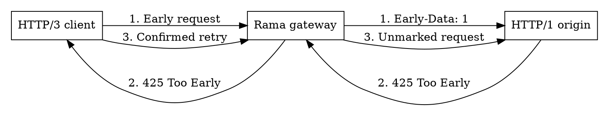

# Early data and HTTP 425

TLS early data (0-RTT) lets a returning client send a request before its new
handshake finishes. This can reduce latency, but those bytes can be replayed.
Rama keeps the decisions separate: the transport reports early use, the
application decides whether to process it, and the original client owns recovery.
**Everything remains handshake-first unless explicitly enabled.**

## How recovery works

An origin returns **425 Too Early** when it cannot safely process an exposed
request. A gateway passes that response back; the original client can retry once
without early data. Reusing the same connection is allowed, but not required.

<div class="book-article-image-center">



</div>

Each terminating hop has its own handshake. The gateway can accept an early H3
request and forward it over ordinary HTTP/1 or HTTP/2. Upstream 0-RTT is not
needed to overlap the downstream handshake with origin work.

## Choosing a policy

- **Clients:** opt into early sending for safe, bodyless requests. The existing
  retry layer handles 425 and TLS early rejection, with one confirmed recovery.
  Payload retry preparation is independently configurable, with optional limits.
- **Servers:** allow early handling only on routes whose behavior is safe under
  replay. Other routes can wait for confirmation. TLS tickets are bound to
  compatible QUIC and HTTP/3 settings; that does not prevent application replay.
- **Gateways:** forward early only when the selected origin understands
  `Early-Data` and 425. Otherwise wait for the incoming handshake. If exposure
  was inherited from an earlier hop, waiting cannot clear it: return 425 instead.

Rama preserves inherited exposure across H1/H2/H3 and ICAP adaptation. Native
TCP TLS early sending/acceptance is not included. The paired `Http3MitmRelay`
remains handshake-first; opaque QUIC forwarding is unaffected.

## Try it and explore the APIs

The [`http_early_data` example](https://github.com/plabayo/rama/blob/main/examples/src/http_early_data.rs)
uses **H3 client -> H3 gateway -> H1 origin** deliberately: an existing HTTP/1
backend can sit behind an early-data-aware H3 front end.

```sh
cargo run -p rama-examples --bin http_early_data --features http-full,boring
```

Use `http-full,rustls,ring` for Rustls. Add `-- --incapable-origin` to make the
gateway wait instead of forwarding early. If the handshake wins the race, no
425 recovery is needed.

Custom services can use the same [transport facts and recovery controls](https://ramaproxy.org/docs/rama/http/proto/ext/early_data/index.html)
without Rama's Retry layer. The client builder helper is optional composition.

Implementation details live in the edge API docs:

- [Client composition](https://ramaproxy.org/docs/rama/http/client/struct.EasyHttpConnectorBuilder.html#method.build_client_with_early_data)
  and [retry policy](https://ramaproxy.org/docs/rama/http/layer/retry/early_data/index.html).
- [Route and gateway policy](https://ramaproxy.org/docs/rama/http/layer/validate_request/early_data/index.html).
- [H3 configuration and settings compatibility](https://ramaproxy.org/docs/rama/http/core/h3/connection/struct.Config.html)
  and [QUIC TLS options](https://ramaproxy.org/docs/rama/quic/tls/struct.TlsOptions.html).

The protocol contracts are in [RFC 8470](https://www.rfc-editor.org/rfc/rfc8470.html)
and [RFC 9114 section 7.2.4.2](https://www.rfc-editor.org/rfc/rfc9114.html#section-7.2.4.2).
