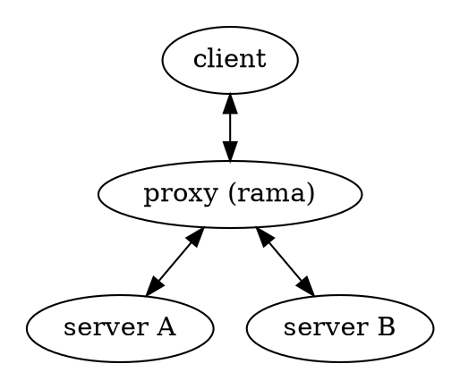

# 🌐 HTTP(S) proxies

<div class="book-article-intro">
    
    <div>
        HTTP(S) proxies forward HTTP requests. The request from the client is the same as a regular HTTP request except the full URL is passed, instead of just the path. Some web proxies allow the HTTP CONNECT method to set up forwarding of arbitrary data through the connection; a common policy is to only forward port 443 to allow HTTPS traffic.
        <p>— <a href="https://en.wikipedia.org/wiki/Proxy_server#Web_proxy_servers">Wikipedia</a></p>
    </div>
</div>

[Examples](https://github.com/plabayo/rama/tree/main/examples):

- [/examples/src/http_connect_proxy.rs](https://github.com/plabayo/rama/tree/main/examples/src/http_connect_proxy.rs):
  Spawns a minimal http proxy which accepts http/1.1 and h2 connections alike,
  and proxies them to the target host.
- [/examples/src/https_connect_proxy.rs](https://github.com/plabayo/rama/tree/main/examples/src/https_connect_proxy.rs):
  Spawns a minimal https connect proxy which accepts http/1.1 and h2 connections alike,
  and proxies them to the target host through a TLS tunnel.

- [/examples/src/http_version_proxy.rs](https://github.com/plabayo/rama/tree/main/examples/src/http_version_proxy.rs):
  A minimal HTTP/1.1, HTTP/2 and HTTP/3 ingress proxy to a plaintext HTTP/1.1 origin,
  plus a CONNECT MITM proxy with username labels for selecting the upstream HTTP version.

## Description

<div class="book-article-image-center">



</div>

You'll notice that the above graph is the exact same one used in
[the Reverse Proxies chapter](./reverse.md). In an abstract topology sense
this is expected, however there are typically differences:

- The client, proxy and server are typically in 3 different intranets,
  with communication going typically over the intranet;
- The use cases of a reverse proxy are very wide, while
  those of the http proxy are pretty specific.

The most common use case of an http(s) proxy is to hide the IP address (L3)
of the client: the proxy opens its own connection to the target server,
so the server sees the proxy's IP address instead of the client's.

```

HTTP Proxy relaying HTTPS requests
------------------------------------

┌────────┐       ┌──────────────┐       ┌────────────────────┐
│ Client │──────▶│ HTTP Proxy   │──────▶│ Target Server (TLS)│
└────────┘       └──────────────┘       └────────────────────┘
     │                 │                        │
     │   1. TCP connect to proxy (e.g., :3128)  │
     │────────────────▶│                        │
     │                 │                        │
     │   2. Send HTTP CONNECT request           │
     │      e.g.,                               │
     │      CONNECT example.com:443 HTTP/1.1    │
     │      Host: example.com:443               │
     │────────────────▶│                        │
     │                 │                        │
     │   3. Proxy establishes TCP to server     │
     │                 │───────────────────────▶│
     │                 │                        │
     │   4. Proxy replies with 200 OK           │
     │◀────────────────│                        │
     │                 │                        │
     │ 5. TLS handshake begins (client ↔ server)│
     │◀────────────────────────────────────────▶│
     │                 │                        │
     │   6. Encrypted HTTP(S) traffic relayed   │
     │◀────────────────────────────────────────▶│

```

> Flow of a regular "HTTP CONNECT" proxy.

In case the client request is encrypted (TLS) it will typically make a
plaintext (http/1.1) request with the "CONNECT" method to the proxy,
which on behalf of the client opens a TCP connection to the target (server).
The TLS handshake itself happens between client and server, through that tunnel.
From there the proxy will:

- either just copy the bytes between the two connections as they are,
  without seeing the decrypted traffic (a regular CONNECT tunnel);
- or act as [a MITM proxy](./mitm.md): terminate the client's TLS itself,
  open its own TLS connection to the target, and read and possibly
  modify the (http) requests in between. In this case it might even act
  as [a distortion proxy](./distort.md).

Only the MITM case requires the client to trust the proxy's TLS certificate,
given it will not match the expected target (server) TLS certificate. Depending on the
client's network policies this might be handled automatically due to the use
of a non-public [root certificate](https://en.wikipedia.org/wiki/Root_certificate).

```plaintext

HTTP Proxy relaying HTTP requests
-----------------------------------

┌────────┐       ┌────────────────┐       ┌────────────────────┐
│ Client │──────▶│ HTTP Proxy     │──────▶│ Target HTTP Server │
└────────┘       └────────────────┘       └────────────────────┘
     │                  │                        │
     │ 1. TCP connect to proxy (:3128)           │
     │─────────────────▶│                        │
     │                  │                        │
     │ 2. Send full HTTP request via proxy       │
     │    e.g.,                                  │
     │    GET http://example.com HTTP/1.1        │
     │    Host: example.com                      │
     │─────────────────▶│                        │
     │                  │                        │
     │ 3. Proxy parses and forwards request      │
     │                  │──────────────────────▶ │
     │                  │                        │
     │ 4. Target server replies with HTTP        │
     │                  │◀────────────────────── │
     │                  │                        │
     │ 5. Proxy may log, modify, or inject       │
     │                  │                        │
     │ 6. Proxy sends HTTP response to client    │
     │◀─────────────────│                        │
     │                  │                        │
     │ 7. Subsequent requests/responses relayed  │
     │◀─────────────────▶│◀─────────────────────▶│

```

Plain text (http) requests are typically immediately made with the Host/Authorization
headers being equal to the desired target server. Which once again looks a lot more
like logic that a [reverse proxy](./reverse.md) would also do among one of its many tasks.
As such HTTP traffic can always be logged, modified or injected by any intermediate party,
including your HTTP proxy.

See the official RFCs for more information regarding HTTP semantics and
protocol specifications.


```plaintext

HTTP Proxy MITM'ing HTTPS requests
------------------------------------

┌────────┐       ┌────────────────────┐       ┌────────────────────┐
│ Client │──────▶│ HTTP Proxy (MITM)  │──────▶│ Target Server (TLS)│
└────────┘       └────────────────────┘       └────────────────────┘
     │                    │                          │
     │ 1. TCP connect     │                          │
     │    to proxy (:3128)│                          │
     │───────────────────▶│                          │
     │                    │                          │
     │ 2. Send CONNECT    │                          │
     │    example.com:443 │                          │
     │───────────────────▶│                          │
     │                    │                          │
     │                    │    3. Proxy replies      │
     │ ◀───────────────── │       with 200 OK        │
     │                    │                          │
     │                    │       4. TLS handshake   │
     │◀─────────────────▶ │          with proxy      │
     │                    │          (fake cert)     │
     │                    │                          │
     │ 5. Proxy connects  │                          │
     │    to target:443   │─────────────────────────▶│
     │ 6. Proxy performs  │                          │
     │    TLS to server   │─────────────────────────▶│
     │                    │                          │
     │                                               │
     │              7. Encrypted HTTPS               │
     │                 relayed via MITM              │
     │                                               │
     │◀──────────────────▶│◀────────────────────────▶│

```

> Flow a MITM proxy handling HTTPS traffic
>
> step (4) to (6) can be done before step (3).
> However rrama by default does these `proxy <-> server` steps
> lazilly only when the first actual http(s) request is received.
