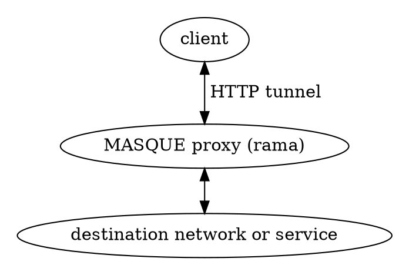

# 🎭 MASQUE proxies

MASQUE brings UDP and IP tunnelling to HTTP proxies. It is useful when traffic
cannot travel through an ordinary TCP `CONNECT` tunnel: HTTP/3 is one example,
because its QUIC connections use UDP.

Rama supports two MASQUE protocols:

- **CONNECT-UDP** tunnels UDP payloads to a particular host and port. Use it to
  reach an HTTP/3 server or another UDP service through a proxy.
- **CONNECT-IP** tunnels complete IPv4 or IPv6 packets. It is a building block
  for VPNs, access to private networks and tunnels between sites.

<div class="book-article-image-center">



</div>

The client asks the proxy to open a tunnel. The proxy authenticates and authorizes
that request, then forwards the permitted traffic. The tunnel is carried over an
encrypted HTTP connection; the application traffic inside can have its own
end-to-end encryption too.

## Quick start

Run a CONNECT-UDP proxy on loopback and send an HTTP/3 request through it:

```sh
rama serve proxy --bind 127.0.0.1:8443 --protocol masque
rama send -v --http3 -x masque://127.0.0.1:8443 --proxy-insecure https://cloudflare-quic.com/
```

The proxy generates a certificate for this local example, hence
`--proxy-insecure`. For a deployed proxy, use a trusted certificate or configure
its CA with `--proxy-cacert FILE`.

A proxy address can include credentials and a custom URI template. See
`rama send --help` and `rama serve proxy --help` for configuration options. The
[`masque_connect_udp_proxy` example][example] shows a client and server in Rust.
The CLI currently exposes CONNECT-UDP; CONNECT-IP is available as a library API.

## CONNECT-UDP

A CONNECT-UDP tunnel has one destination: a host and UDP port. The proxy resolves
that destination and checks its access policy before accepting traffic. Rama's
default destination policy rejects private, loopback and link-local addresses;
applications can explicitly allow the networks they intend to expose.

For an HTTP client, a `masque://` proxy lets HTTP/3 use CONNECT-UDP while HTTP/1.1
and HTTP/2 use ordinary TCP `CONNECT`. A proxy serving both can therefore carry
all three HTTP versions. Proxies can also be chained through a MASQUE upstream.

Start with [`rama::proxy::masque::connect_udp`][connect-udp]:
`ConnectUdpConnector` opens a tunnel as a UDP socket, and `ConnectUdpService`
serves tunnels with configurable destination policy and forwarding. For web
requests, `DefaultHttpWebClient::default_masque_with_executor` provides the
integrated client.

## CONNECT-IP

CONNECT-IP works one level below UDP: each payload is a whole IP packet. That
allows a tunnel to carry TCP, UDP, ICMP and other IP protocols. Peers can also
exchange address assignments and advertise which destinations they can reach.
Those advertisements describe connectivity; local policy still decides what
traffic is allowed.

[`rama::proxy::masque::connect_ip`][connect-ip] provides `ConnectIpRequestBuilder` and
`ConnectIpConnector` for clients, and `ConnectIpService` for servers. Your
application supplies admission policy and a handler that sends and receives packets through a `ConnectIpSession`.
Your application owns the packet engine and chooses where packets go.

Connecting ordinary applications to such a tunnel also needs an OS packet
interface, such as Linux TUN, plus routing configuration. Rama's CONNECT-IP
module does not create interfaces, change host routes or configure DNS. These
platform integrations are separate from the tunnel protocol.

The reusable [`rama::net::ip`][ip] module handles IP packet parsing, construction,
checksums and ICMP helpers. It can also be used independently of MASQUE.

## How traffic travels

Both protocols can use HTTP/1.1, HTTP/2 or HTTP/3. When using Rama as a library,
enable `masque` for the tunnel APIs and `http-backend` for the HTTP engines;
HTTP/3 also requires `quic` (`http-full` includes all three). The HTTP layer
handles the handshake and chooses the available delivery mechanism:

| Delivery | What it means |
|---|---|
| Native HTTP/3 datagrams | Packets may be lost or reordered, without waiting for retransmission of earlier packets. |
| Capsules on the HTTP stream | Packets travel as framed messages over a reliable stream. Loss can delay later packets while the stream recovers. |

HTTP/1.1 and HTTP/2 use capsules. HTTP/3 can use native datagrams when negotiated,
with capsules providing compatibility otherwise. Native datagrams are a natural
fit for UDP and for tunnelling QUIC; capsules let a tunnel work through paths
that only support reliable HTTP streams.

Packet sizes matter too: encapsulation needs room around the original packet.
Rama exposes tunnel limits, and CONNECT-IP requires a verified minimum link MTU
before enabling IPv6. A packet that exceeds a native datagram limit is not
silently switched to reliable delivery. See the session API docs for MTU,
forwarding and timeout configuration.

## Composing a proxy

MASQUE uses Rama's usual services and layers. Authentication identifies the
caller; admission and destination policy decide what they may reach. Tunnel and
traffic budgets bound resource use. A custom packet handler or relay can inspect
or transform permitted traffic.

The main entry points are:

| Purpose | Module |
|---|---|
| UDP clients, servers and target policy | [`rama::proxy::masque::connect_udp`][connect-udp] |
| IP clients, servers and packet policy | [`rama::proxy::masque::connect_ip`][connect-ip] |
| Shared HTTP datagram sessions and capsule framing | [`rama::http::datagram`][datagram] |
| IP packet primitives | [`rama::net::ip`][ip] |

For interception of a client's CONNECT-UDP proxy connection, see the
[`connect_udp::mitm` adapters][mitm] and the [MITM chapter](./mitm.md).
They allow the relay to preserve the client's tunnel or apply a custom service.
Selecting traffic for interception and authorizing that traffic are separate
application decisions.

Tunnel statistics and optional OpenTelemetry integration are described in the
API docs. For a quick look at CONNECT-UDP activity, enable
`RUST_LOG=rama_masque=debug`. When a proxy refuses a tunnel, its `Proxy-Status`
response header can help explain why.

For protocol details, see [CONNECT-UDP (RFC 9298)][rfc-udp],
[CONNECT-IP (RFC 9484)][rfc-ip] and [HTTP Datagrams and Capsules (RFC 9297)][rfc-datagram].

[example]: https://github.com/plabayo/rama/blob/main/examples/src/masque_connect_udp_proxy.rs
[connect-udp]: https://ramaproxy.org/docs/rama/proxy/masque/connect_udp/index.html
[connect-ip]: https://ramaproxy.org/docs/rama/proxy/masque/connect_ip/index.html
[datagram]: https://ramaproxy.org/docs/rama/http/datagram/index.html
[ip]: https://ramaproxy.org/docs/rama/net/ip/index.html
[mitm]: https://ramaproxy.org/docs/rama/proxy/masque/connect_udp/mitm/index.html
[rfc-udp]: https://www.rfc-editor.org/rfc/rfc9298.html
[rfc-ip]: https://www.rfc-editor.org/rfc/rfc9484.html
[rfc-datagram]: https://www.rfc-editor.org/rfc/rfc9297.html
