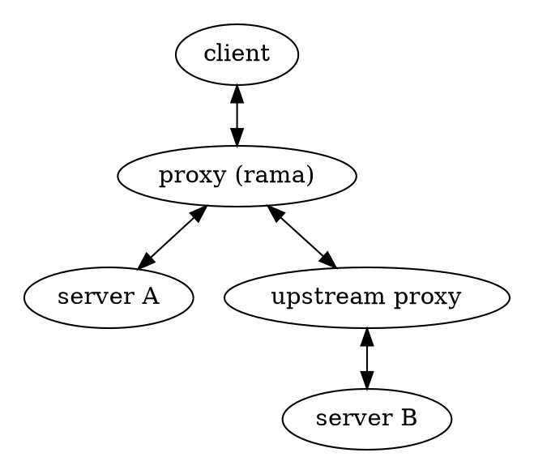

# 🔎 MITM Proxies

    
    

        A Man-In-The-Middle (MITM) proxy is a proxy placed between the client and the server.
        While this positioning is common to all proxies, what distinguishes an MITM proxy is its
        active interpretation of application layer packets. Although it may modify packets as they pass through,
        its primary function is typically to inspect and track the traffic.
    

[Examples](https://github.com/plabayo/rama/tree/main/examples):

- [/examples/src/http_mitm_proxy_boring.rs](https://github.com/plabayo/rama/tree/main/examples/src/http_mitm_proxy_boring.rs):
  The recommended starting point for a MITM proxy. It is built from the Relay/Peek services:
  the CONNECT target is established before success is returned, TLS is mirrored and HTTP is
  relayed over that one egress connection. Also shows WebSocket relaying and inspection of
  decoded bodies.
  - Similar to [/examples/src/http_connect_proxy.rs](https://github.com/plabayo/rama/tree/main/examples/src/http_connect_proxy.rs)
    but with MITM capabilities for both HTTP and HTTPS requests.

- [/examples/src/http_mitm_relay_proxy_boring.rs](https://github.com/plabayo/rama/tree/main/examples/src/http_mitm_relay_proxy_boring.rs):
  A smaller version of [/examples/src/http_mitm_proxy_boring.rs](https://github.com/plabayo/rama/tree/main/examples/src/http_mitm_proxy_boring.rs)
  on the same Relay/Peek services, without WebSocket or body handling. It marks each request
  and prints the final egress headers, which makes it the shortest way into this design.

- [/examples/src/http_mitm_proxy_emulate_boring.rs](https://github.com/plabayo/rama/tree/main/examples/src/http_mitm_proxy_emulate_boring.rs):
  Unlike the relays above, which mirror the client, this proxy terminates TLS and
  sends each request through its own client that emulates a captured browser profile
  (TLS ClientHello, HTTP/2 settings and headers). Each client chooses the profile
  with proxy-auth username labels, such as `john-ua_chrome-ua_macos`.

- [/examples/src/tls_mitm_relay_client_auth.rs](https://github.com/plabayo/rama/tree/main/examples/src/tls_mitm_relay_client_auth.rs):
  A self-contained mTLS relay that authenticates an ingress client and maps it to
  a different upstream identity. Also demonstrates independent ingress admission
  and rejection of missing, untrusted or unmapped client certificates.

- [/examples/src/mitm_ocsp_relay_gate.rs](https://github.com/plabayo/rama/tree/main/examples/src/mitm_ocsp_relay_gate.rs):
  Test harness behind the MITM OCSP-stapling gate: a local upstream TLS server
  plus the boring relay proxy, exercising the mirror -> issue -> staple flow so an
  external client (`curl --cert-status` / `openssl s_client -status`) can validate
  the stapled leaf. Driven by `scripts/ocsp-relay-gate.sh` (`just test-ocsp-gate`).

- [/examples/src/http_mitm_proxy_rustls.rs](https://github.com/plabayo/rama/tree/main/examples/src/http_mitm_proxy_rustls.rs):
  A Rustls compatibility example that terminates ingress TLS by hand and connects egress
  per decrypted request, because a paired Rustls TLS relay is not available yet. Its CONNECT
  success does not prove egress reachability. Prefer
  [/examples/src/http_mitm_proxy_boring.rs](https://github.com/plabayo/rama/tree/main/examples/src/http_mitm_proxy_boring.rs) for a new proxy.

The `http_mitm_*` examples above accept HTTP/1.1 and HTTP/2 over TCP. A client that tunnels
through CONNECT cannot carry HTTP/3 to its target, so none of them speak QUIC. To intercept
HTTP/3 see [/examples/src/quic_h3_mitm_proxy.rs](https://github.com/plabayo/rama/tree/main/examples/src/quic_h3_mitm_proxy.rs), which listens on
UDP, peeks the QUIC ClientHello and terminates HTTP/3 for the server names you choose.
For proxying UDP through an HTTP proxy see
[/examples/src/masque_connect_udp_proxy.rs](https://github.com/plabayo/rama/tree/main/examples/src/masque_connect_udp_proxy.rs), which serves
CONNECT-UDP (RFC 9298, one of the MASQUE protocols) next to ordinary CONNECT on one port.

The principles stay the same across transports, so these examples can be combined:

- the Relay/Peek design of `http_mitm_proxy_boring` and `http_mitm_relay_proxy_boring` is what
  `quic_h3_mitm_proxy` applies to QUIC: peek the ClientHello, mirror TLS, then relay HTTP
  through your own HTTP middleware. A proxy can run both, with CONNECT-UDP as the way in
  for clients that only know an HTTP proxy;
- the terminate and re-send design of `http_mitm_proxy_emulate_boring` applies to HTTP/3 too,
  as captured profiles describe HTTP/3 as well. The egress client then needs an HTTP/3
  connector and the proxy a UDP ingress, both adapted to carry the selected profile.

## Description

An MITM proxy is typically set up as [an HTTP Proxy](./http.md), but it can alternatively be configured as [a SOCKS5 proxy](./socks5.md).

## Transparent Proxies

MITM proxies that only wish to inspect traffic without destructive modification can attempt to mirror the incoming client across various network layers (TCP, TLS, and HTTP). This approach is a form of User-Agent emulation, but it operates based on the original User-Agent rather than emulating a popular one with significant market share.

These proxies are often referred to as transparent proxies, and you may notice network inspection software offering options labeled as "transparent mode" or "hidden." If such software can still inspect your HTTPS traffic, it's likely operating as a "transparent proxy."

## Reusable inspection and programmatic control

`rama-inspect` provides protocol-independent lifecycle, typed interception waits,
streamed record storage, and subscriptions for custom interfaces. HTTP, TLS,
profile, WebSocket, and encryption adapters live in their owning crates. Combine
`inspect` with the protocol and crypto features you use. See the
[`rama-inspect` guide](https://github.com/plabayo/rama/tree/main/rama-inspect).

The CLI inspector also exposes a machine API on the same authenticated web server.
Start `rama serve proxy --mitm --inspect-json` for JSON readiness information, or
use the token in the normal startup link. Send `Authorization: Bearer <token>` to
`GET /api` for operation discovery and `/api/help` for the observe -> select hosts ->
intercept -> export workflow. No browser session or MCP server is required. A human
can continue using the GUI while an agent queries traffic or operates the controls.
