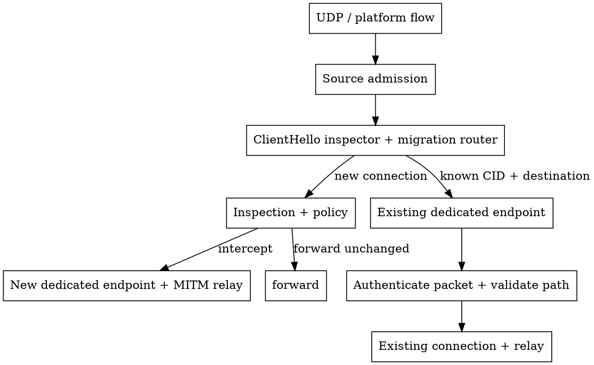

# QUIC MITM across changing flows

A QUIC connection can outlive the UDP flow that first carried it. Transparent proxies
may receive a new platform flow when an application changes its socket. Migration
routing joins that flow to its original connection; **independent client connections
keep independent endpoints, relays and origin connections**.

`QuicMitmIngress` connects the ClientHello inspector with the MITM relay. It routes a new
platform flow back to an existing connection when the original destination and connection
identifier match. Ordinary traffic stays on that connection's dedicated endpoint.
A match is only a routing hint: QUIC must still authenticate the packet and validate the path.
Rejected known traffic is dropped, never forwarded to another origin.

Keep registries within a trusted policy identity, such as one process generation or one
authenticated tunnel tenant. `QuicMitmIngressByIdentity` manages these isolated registries;
unknown identities must remain isolated too. Apply source admission before routing, including
to known-CID flows, to bound path churn. The logical connection and its admission guards
must outlive the individual platform flows that carry it.

### Bounds and flow lifetime

Registration budgets limit migration bookkeeping, separately from flow admission. At capacity,
new connections can still use independent endpoints, but cannot migrate between platform flows.
Existing registrations remain available until their connections close. Path budgets apply
per connection, so an interface change can move many connections at once. Use telemetry to
see whether these budgets fit your workload and when capacity pressure disables migration support.

One platform association carries one intercepted connection. A second handshake on its active
tuple is refused; supporting several independent connections on that tuple needs a different
transport arrangement. Obsolete paths can be retired, but the authenticated current path
is protected. Reusing that active tuple remains subject to its original flow lifetime.

### Ingress and egress move independently

A client's port change usually leaves the origin-facing connection alone. A network or policy
change can require reassessing either side. `QuicMigrationLayer` makes that decision explicit:
keep a path, refresh its transport information, or replace its transport. `QuicEgressMigration`
adapts a replacement-socket factory to this policy. New ingress flows join their existing
connection through the router; egress changes remain subject to QUIC's migration constraints.

Network observations are hints, not proof that a particular connection failed. Reuse the
original connector and its policy restrictions when preparing a replacement. Bound concurrent
preparations during network-wide changes, set decision deadlines, and choose whether a failed
preparation preserves the connection or closes it. Newer observations supersede unfinished work.

The Apple example uses provider network-path observations to reassess egress when connectivity
returns. An ingress port change alone does not replace egress. Physical interface changes and
recovery still need platform testing.

See the [migration API reference](https://ramaproxy.org/docs/rama/quic/proxy/index.html)
and [telemetry reference](https://ramaproxy.org/docs/rama/quic/dial9/index.html) for configuration
and event details. The [conditional QUIC MITM example](https://github.com/plabayo/rama/blob/main/examples/src/quic_h3_mitm_proxy.rs)
and [Apple transparent-proxy example](https://github.com/plabayo/rama/tree/main/ffi/apple/examples/transparent_proxy)
show how the layers fit into a complete proxy.

The model follows [QUIC path validation and migration](https://www.rfc-editor.org/rfc/rfc9000.html#section-9),
[MsQuic's distinct local/peer address events](https://github.com/microsoft/msquic/blob/main/docs/api/QUIC_CONNECTION_EVENT.md),
and [Apple's network path observations](https://developer.apple.com/documentation/network/nwpathmonitor/).
