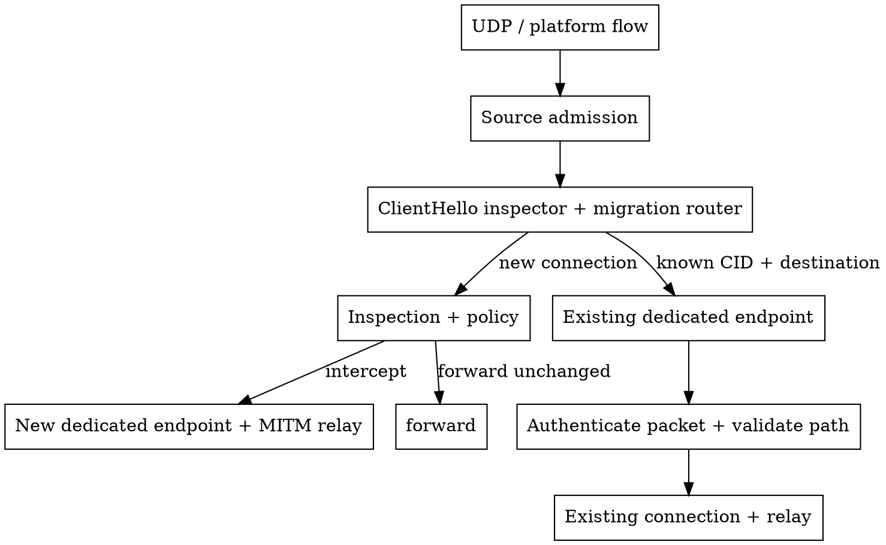

# QUIC MITM across changing flows

A QUIC connection can outlive the UDP flow that first carried it. Transparent proxies
may receive a new platform flow when an application changes its socket. Migration
routing joins that flow to its original connection; **independent client connections
keep independent endpoints, relays and origin connections**.

Install `QuicMitmIngress` through the inspector's `with_router`, and give the same
instance to `QuicMitmRelay::with_migration_ingress`. One registry represents one trusted
routing identity boundary (for example one process generation, not a DNS name); it indexes the original destination and identifiers published by the
native endpoint. Established traffic never looks up this registry. A positive routing
hint is terminal: native rejection or closure drops the packet, never forwards it elsewhere.

`QuicMitmIngressByIdentity<Key>` bounds a reusable collection of isolated registries. Choose
a trusted platform/policy key, such as an Apple audit token including process generation.
Missing or ambiguous identity must keep flows isolated. After policy selects interception,
`run_connection` moves that connection's work and admission guards into the provider scope;
raw forwarding retains normal caller cancellation. Connection closure releases its paths.

One platform association still carries one intercepted QUIC connection. A second handshake
on its active tuple is refused promptly; multiplexing independent connections on one tuple
requires a different CID-dispatch transport. Unknown traffic can retire an obsolete association
so retransmission is routed afresh, but cannot evict the authenticated current path. Reuse of
that still-active tuple remains subject to its original flow lifetime.

`DatagramSocketGroup` polls the connection's attached transports directly into endpoint
buffers, without an additional payload queue or copy. It retains native MTU, ECN and
segmentation capabilities; incompatible paths are refused. Keep the per-connection path
bound small. Readiness bookkeeping and a per-transport receive lock still have costs;
measure these separately from platform queues and QUIC cryptography.

The identity and connection-registration bounds are **migration bookkeeping budgets**, separate
from flow admission. At capacity, new work uses an ordinary independent endpoint without
migration registration. Existing registrations remain until connection closure, ready for
future moves. Path bounds apply per connection, not to concurrent migrations across the proxy.
Many connections can therefore move together after an interface change.

Ingress and origin-facing QUIC connections are separate. An ingress port change alone
need not move egress. An interface or policy change can require reassessing either side;
QUIC address-change rules still apply. Ordinary upstream NAT rebinding does not require
joining local platform flows.

For automatic reassessment, wrap the established relay in `QuicMigrationLayer`. Its policy
receives validated path changes and trusted `QuicNetworkChanges` snapshots, then chooses
`Keep`, `Refresh` or `Replace` independently for each leg. `QuicEgressMigration` is a small
adapter for a replacement-socket factory. Reuse the initial connector and its policy
extensions; a reachability hint must never bypass a tunnel or interface restriction.
Registered transparent ingress keeps its path aggregate: `Replace` is refused there;
new platform flows join through the router. Egress replacement requires a dedicated endpoint
and remains subject to QUIC role, handshake and peer migration constraints.

Updates coalesce; newer observations cancel unfinished policy decisions. Set a decision
deadline and choose explicitly whether failure keeps existing paths or closes both legs.
The optional supervisor runs in the provider scope, with no payload channel or per-packet
policy callback. Use `with_decision_gate` to share a preparation concurrency bound across
connections. Waiting for admission does not consume the decision deadline; connection closure
and newer network observations still cancel queued work. The gate does not bound native path validation.

The Apple example publishes provider `NWPathMonitor` observations and replaces egress through
its original UDP connector when the network becomes available. An ingress port change alone
does not replace egress. A provider-wide observation is a policy hint, not proof of any
individual flow's route. Physical interface changes and recovery still need platform testing.

This separation follows [QUIC path validation and migration](https://www.rfc-editor.org/rfc/rfc9000.html#section-9),
[MsQuic's distinct local/peer address events](https://github.com/microsoft/msquic/blob/main/docs/api/QUIC_CONNECTION_EVENT.md),
and [Apple's network path observations](https://developer.apple.com/documentation/network/nwpathmonitor/).

See the [conditional QUIC MITM example](https://github.com/plabayo/rama/blob/main/examples/src/quic_h3_mitm_proxy.rs)
and [Apple transparent-proxy example](https://github.com/plabayo/rama/tree/main/ffi/apple/examples/transparent_proxy).

### Observe capacity

`QuicMitmIngress::routing_stats()` exposes registration occupancy, high-water marks,
route hits/misses and rejected registrations. `unregistered_connections()` counts
new connections that continued independently when registration was full.
`QuicMitmIngressByIdentity::stats()` reports identity-cache occupancy, reuse,
reaping and rejection totals. These limits govern migration support, not flow admission.

With `dial9`, `QuicRoutingSnapshot` and `QuicMigrationCapacity` record control-plane
snapshots, including connection-path attachment, eviction totals and validation timeouts.
Resource IDs correlate events without recording addresses, connection IDs or process identities.
Path occupancy is sampled at the event; it is not a continuously maintained gauge.
The `rama_quic::migration` tracing target provides the same lifecycle diagnostics;
capacity fallback messages at debug level are logarithmically sampled.
Updates follow routing and lifecycle events, not each established datagram.
