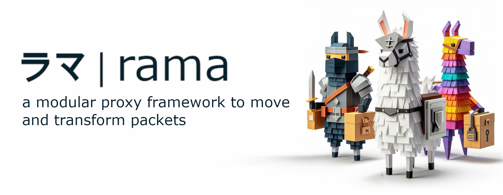

[![Crates.io][crates-badge]][crates-url]
[![Docs.rs][docs-badge]][docs-url]
[![MIT License][license-mit-badge]][license-mit-url]
[![Apache 2.0 License][license-apache-badge]][license-apache-url]
[![rust version][rust-version-badge]][rust-version-url]
[![Build Status][actions-badge]][actions-url]

[![Discord][discord-badge]][discord-url]
[![Buy Me A Coffee][bmac-badge]][bmac-url]
[![GitHub Sponsors][ghs-badge]][ghs-url]
[![Paypal Donation][paypal-badge]][paypal-url]

[crates-badge]: https://img.shields.io/crates/v/rama.svg
[crates-url]: https://crates.io/crates/rama
[docs-badge]: https://img.shields.io/docsrs/rama/latest
[docs-url]: https://docs.rs/rama/latest/rama/index.html
[license-mit-badge]: https://img.shields.io/badge/license-MIT-blue.svg
[license-mit-url]: https://github.com/plabayo/rama/blob/main/LICENSE-MIT
[license-apache-badge]: https://img.shields.io/badge/license-APACHE-blue.svg
[license-apache-url]: https://github.com/plabayo/rama/blob/main/LICENSE-APACHE
[rust-version-badge]: https://img.shields.io/badge/rustc-1.96+-blue?style=flat-square&logo=rust
[rust-version-url]: https://www.rust-lang.org
[actions-badge]: https://github.com/plabayo/rama/actions/workflows/CI-status.yml/badge.svg?branch=main
[actions-url]: https://github.com/plabayo/rama/actions/workflows/CI.yml

[discord-badge]: https://img.shields.io/badge/Discord-%235865F2.svg?style=for-the-badge&logo=discord&logoColor=white
[discord-url]: https://discord.gg/29EetaSYCD
[bmac-badge]: https://img.shields.io/badge/Buy%20Me%20a%20Coffee-ffdd00?style=for-the-badge&logo=buy-me-a-coffee&logoColor=black
[bmac-url]: https://www.buymeacoffee.com/plabayo
[ghs-badge]: https://img.shields.io/badge/sponsor-30363D?style=for-the-badge&logo=GitHub-Sponsors&logoColor=#EA4AAA
[ghs-url]: https://github.com/sponsors/plabayo
[paypal-badge]: https://img.shields.io/badge/paypal-contribution?style=for-the-badge&color=blue
[paypal-url]: https://www.paypal.com/donate/?hosted_button_id=P3KCGT2ACBVFE

🦙 rama® (ラマ) is a modular service framework for the 🦀 Rust language to move and transform your network packets.
The reasons behind the creation of rama can be read in [the "Why Rama" chapter](https://ramaproxy.org/book/why_rama).

## rama-cli

`rama-cli` is the official rama binary, which can be used to proxy requests, make requests and inspect your traffic. It serves mostly as an example to showcase some of what you can do with rama, but of course if you wish you can also use it for your actual production use cases, just know we give no guarantees of any kind.

### User-agent tools

`rama ua parse '<User-Agent>'` describes the recognized family, version,
platform and device. Add `-j` or `--json` for JSON output.

`rama ua view profiles.json` browses captured profiles in a terminal. Use `/`
to filter, arrow keys to select, Page Up/Down to scroll details, and `q` to quit.
The overview shows observed protocols, counts, freshness and sampling coverage.
`--summary` prints a compact list; piped output uses that format automatically.

Without a path, `rama ua view` reads `RAMA_FP_DATABASE_URL`, as does
`rama ua export --output profiles.json`. Both read public observations from the
last 14 UTC day buckets by default; `--days` changes the window and `--authorized`
selects the authorized partition. Export validates every profile before publishing
the file; `--replace` permits replacing an existing destination.

`--embed` writes the precompiled profile set that rama-ua embeds: the profiles
are analyzed at export time, so loading only decompresses and decodes them
(`just update-embedded-profiles` refreshes it from the production fp database
over Fly's WireGuard network, with `RAMA_FP_DATABASE_URL` set).
`rama ua compact profiles.json --output embed_profiles.bin` compiles an existing
archive the same way. Both leave out profiles that hold only imported legacy fields,
since profile selection cannot draw them; `--include-legacy` keeps them. `rama ua view` and `rama ua compare` read archives and
compiled sets; `rama ua view --embedded` shows the profiles built into the binary.

`rama ua export --import-legacy --authorized --output profiles.json` imports the
retained legacy rows into the counted store before exporting. Import is additive
and restart-safe; source tables remain unchanged. Each non-null legacy field has
conventional weight one and unknown history. Its day comes from the row's last
update, which cannot recover individual fields' original capture times.

`rama send --emulate=profiles.json --http1.1 http://localhost:8080/report`
loads a counted export through captured-profile replay. Supply the
request-owned fields required by the captured flow, for example
`--header 'Connection: keep-alive'`; the destination supplies `Host`, and captured
cookies or credentials are never copied. Fresh cleartext HTTP/1 captures retain
an explicit empty connection tuple. Older header-only exports without that tuple
need a fresh capture. Captured TLS (TCP and QUIC), QUIC transport parameters and
first-flight layout, H2 early frames and H3 SETTINGS, startup sequence and QPACK
state are replayed where the stack can reproduce them; anything else is lowered,
traced and reported in the preservation report, never failing the request.
Archives exported from either storage partition load. Files in the older
one-row-per-browser format are converted into captured profiles when loaded, and
the bare `--emulate` flag uses the profiles embedded in the binary. A request's own
`User-Agent` header picks a profile of the same browser (any platform if its own
is missing); without one, any profile can be picked, and an unknown browser fails.

Select a request flow with `--emulate-initiator navigate|fetch|xhr|form|ws`.
For example, `--emulate-initiator form --request POST` selects a captured POST
form flow; it does not synthesize form data or bypass method, protocol, or
connection-context matching. Requests default to navigation. When emulation
is enabled, `ws://` and `wss://` requests default to the WebSocket flow; an explicit
initiator must agree with whether the URI is WebSocket. The option requires
`--emulate`.

Body metadata remains request-owned. An explicit `Content-Type` overrides the
`--data`, `--json`, and `--binary` defaults; multipart retains its generated
boundary. File and stdin data stream without a promised `Content-Length`, so
exact replay needs a capture with compatible framing; otherwise the framing
difference is reported and the request is still sent.

Explicit `Sec-WebSocket-Extensions` and `Sec-WebSocket-Protocol` headers are
retained by the WebSocket handshake builder; `--subprotocol` overrides a protocol
header. Invalid offers fail before sending. Without an explicit extension offer,
the CLI keeps its default permessage-deflate offer. When replaying a captured
WebSocket profile, supply its extension offer explicitly so response negotiation
uses the same offer as the emulated wire request.

To reproduce captured-profile draws, pass all three 64-digit hexadecimal inputs:
`--emulate-seed HEX64 --emulate-connection-key HEX64 --emulate-request-key HEX64`.
Keep the archive, classifier/draw revision, flow, seed and keys unchanged for the
same selection. Change the request key for an independent request draw, or the
connection key for a new logical connection. Without these options, draws remain
random.

Optionally add `--emulate-connection-variant HEX64` and/or
`--emulate-request-variant HEX64` to pin exact canonical joint variant IDs.
Pins require all three draw inputs and must belong to the selected compatible
scope; unknown or incompatible pins fail. Pinning a tuple does not imply support
for its TLS/QUIC wire compiler or freeze generated reserved values independently
of the draw inputs. Automatic redirects reuse these explicit logical draw keys.

### Proxy interception

Start the inspector with `rama serve proxy --mitm`. Forwarding is automatic by
default; add `--intercept` or enable **Intercept · require approval** in the
inspector to hold HTTP request and response headers and WebSocket application
messages in both directions. The pending queue is shared across browser tabs,
ordered by arrival, and independent of capture limits. Inspection requires the
inspector to be running. Queued items appear inline in the request list; use
**Awaiting approval** to show only queued traffic, oldest first.

Open a pending item to edit headers or a WebSocket text/binary message, **Forward**
it, or **Block** it. Repeated headers are preserved. HTTP bodies stay streaming;
framing, routing and upgrade headers cannot be changed in the header editor.
**Respond locally** replaces the entire HTTP response. Templates cover a 403,
redirects, 304, 204, 404, 429, 503, and JSON; they can be edited, saved as presets,
or replaced with a response built from scratch. Redirects require a destination;
a 304 requires a conditional GET/HEAD and simulates an unchanged representation.
WebSocket messages can be dropped individually or the WebSocket can be closed.
Ping replies and close handshakes continue while application messages are held.

**Forward automatically for this connection** also releases its other pending
items and applies to subsequent messages, including other HTTP/2 streams on the
same connection. The connection can be returned to interception from the request list. Automatic response/drop/close rules still apply. Turning interception off
only affects new items; **Forward all and turn off** also releases the queue.
Pending approvals expire after five minutes by default: HTTP receives 504 and
WebSockets close. Queue overflow returns 503 or closes the WebSocket, never an
implicit approval. Limits and the default blocked response are configurable.

Use **Rules** or **Create rule** on captured/pending traffic to match host, path,
protocol, direction, method, port, message kind, status, and header values.
Conditions in one rule are combined. A plain host matches exactly; `.example.com`
also matches subdomains; host/path/header globs support `*`. Empty fields match
all values, including future protocol names. Response/drop/close rules run first
in list order, followed by the first matching approval/automatic-forwarding rule.
With interception on, unmatched traffic requires approval. Applying a new rule to
already pending traffic is an explicit option.

For discovery, start with `rama serve proxy --mitm --mitm-scope none`, or select
**None** under MITM domain scope. The **Hosts** pane records observed destinations,
connection counts, uninspected counts, and last-seen times without decrypting
traffic. Sort by recency or count, then add relevant hosts to **Selected** scope.
An empty Selected scope inspects nothing. Scope changes apply to new TLS
connections; existing tunnels cannot be upgraded. CLI allow/deny restrictions
remain a ceiling and deny rules win. Scope domain patterns preserve their existing
subdomain behavior; `=example.com` selects exactly one host.

**Pause inspector** stops MITM, capture, host observations and traffic rules.
New connections pass through unchanged. Existing inspected connections are closed
because established TLS/WebSocket sessions cannot become opaque tunnels; clients
can reconnect through the paused proxy. Remaining HTTP approvals are forwarded
unchanged and interception is turned off. Scope and rules are retained for resume.
An active HAR is finalized and kept for download; start a new HAR after resuming.
Settings belong to the running proxy. Opening a browser restores display filters
only; saved browser preferences never overwrite live traffic policy. Use the
explicit settings export/import controls to transfer policy between runs.

The queue holds at most 128 messages by default (256 configurable), 256 KiB per
editable item, and 8 MiB of queued message data. WebSocket read-ahead during a
hold is separately bounded to 16 messages / 256 KiB per direction; exceeding it
closes the connection. The host inventory retains up to 4,096 recent hosts.

Profile export and database viewing skip profiles that exceed the analysis limits
and report the count. They also report when the profile or analysis-work budget is
reached. Archive files remain strictly validated. Human-readable labels and errors
escape terminal controls and invisible direction markers.

Captured HTTP/3 SETTINGS use the selected profile's matching connection-context
analysis. Constant reserved entries and insufficient-sample lists retain their
selected literals. A classified varying reserved position gets a connection-keyed
ID draw; high-distinctness values get an independent draw, while repeated values
remain part of the weighted complete tuple. Generated widths are inferred from
retained samples and capped at the QUIC varint limit; this is a bounded heuristic,
not a browser-specific distribution claim. A sorted rule sorts the emitted IDs.
When analysis is missing or ambiguous, replay retains the tuple and reports
`UnanalyzedHttp3ReservedSettings`.

### Literal retained-capture comparison

`rama ua compare --literal reference.json replay.json` revalidates and reanalyzes
both counted archives, then compares complete retained tuples in matching profile,
flow and connection contexts. It prints JSON with field paths and exits nonzero on
mismatches, missing contexts, empty evidence or exhausted limits. A reference
context must be exercised, but each retained variant is an alternative: one replay
need not exercise every variant. `--allow-partial-coverage` explicitly permits
unexercised reference contexts while listing them and setting
`reference_coverage_complete` to false in the report. Complete joint evidence is required; independent
component matches cannot prove correlations. `--authorized` selects the authorized
partition in both input archives.

This explicitly selected literal mode checks captured IDs, values, ordering and
layout against complete retained variants. It does not yet accept newly generated
orders or values, test population frequencies, import pcaps or certify full wire
equivalence. Connection secrets and request-owned values retain their canonical
bindings rather than their original bytes; use independent packet decoding to
verify those runtime values. A mismatch's field report uses the first retained
reference variant, and identifies both capture hashes. Truncated diagnostics never
turn a mismatch into a match. The command reads at most 64 MiB per archive and
compares at most 256 scopes/variants with a shared 16 MiB comparison-work budget.

### Real-browser capture and replay

`just examples/tests/browser-profile /path/to/new-evidence-directory h1 chrome` runs all
six operations: navigation, fetch, XHR, WebSocket, POST form and GET form. It
exports an isolated fp database, replays requests with fixed draw keys, and
compares stored observations and independently decoded request headers and bodies.
Use `firefox` instead of `chrome` for the Firefox H1 fixture, or use the
`examples/tests/browser-profile-release` recipe for the optimized CLI. An optional fourth
argument, `navigate`, limits H1 coverage to navigation; all flows are the default.

The same runner accepts `h2` and `h3` with Chrome or Edge. These TLS fixtures
currently verify original capture, including per-flow protocol, retained headers,
request bodies and WebSocket Extended CONNECT; TLS/QUIC replay verification
remains unfinished. The browser journey is shared with nightly BrowserStack collection.
See the [browser prerequisites and coverage limits](../examples/tests/browser_profile/README.md).

`rama ua view --json profiles.json` provides validated, decoded retained captures
for packet comparisons or offline diagnostics. It reanalyzes the archive's
capture evidence, requires a file, and cannot be combined with `--summary`.
The full browser/version matrix, transport fingerprint replay and modeled
distribution comparison remain pending.
