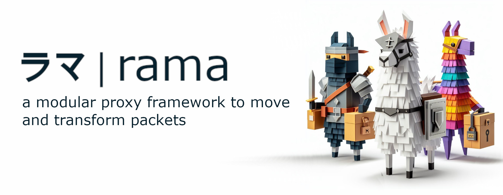

[![Crates.io][crates-badge]][crates-url]
[![Docs.rs][docs-badge]][docs-url]
[![MIT License][license-mit-badge]][license-mit-url]
[![Apache 2.0 License][license-apache-badge]][license-apache-url]
[![rust version][rust-version-badge]][rust-version-url]
[![Build Status][actions-badge]][actions-url]

[![Discord][discord-badge]][discord-url]
[![Buy Me A Coffee][bmac-badge]][bmac-url]
[![GitHub Sponsors][ghs-badge]][ghs-url]
[![Paypal Donation][paypal-badge]][paypal-url]

[crates-badge]: https://img.shields.io/crates/v/rama-http-core.svg
[crates-url]: https://crates.io/crates/rama-http-core
[docs-badge]: https://img.shields.io/docsrs/rama-http-core/latest
[docs-url]: https://docs.rs/rama-http-core/latest/rama_http_core/index.html
[license-mit-badge]: https://img.shields.io/badge/license-MIT-blue.svg
[license-mit-url]: https://github.com/plabayo/rama/blob/main/LICENSE-MIT
[license-apache-badge]: https://img.shields.io/badge/license-APACHE-blue.svg
[license-apache-url]: https://github.com/plabayo/rama/blob/main/LICENSE-APACHE
[rust-version-badge]: https://img.shields.io/badge/rustc-1.96+-blue?style=flat-square&logo=rust
[rust-version-url]: https://www.rust-lang.org
[actions-badge]: https://github.com/plabayo/rama/actions/workflows/CI-status.yml/badge.svg?branch=main
[actions-url]: https://github.com/plabayo/rama/actions/workflows/CI.yml

[discord-badge]: https://img.shields.io/badge/Discord-%235865F2.svg?style=for-the-badge&logo=discord&logoColor=white
[discord-url]: https://discord.gg/29EetaSYCD
[bmac-badge]: https://img.shields.io/badge/Buy%20Me%20a%20Coffee-ffdd00?style=for-the-badge&logo=buy-me-a-coffee&logoColor=black
[bmac-url]: https://www.buymeacoffee.com/plabayo
[ghs-badge]: https://img.shields.io/badge/sponsor-30363D?style=for-the-badge&logo=GitHub-Sponsors&logoColor=#EA4AAA
[ghs-url]: https://github.com/sponsors/plabayo
[paypal-badge]: https://img.shields.io/badge/paypal-contribution?style=for-the-badge&color=blue
[paypal-url]: https://www.paypal.com/donate/?hosted_button_id=P3KCGT2ACBVFE

🦙 rama® (ラマ) is a modular service framework for the 🦀 Rust language to move and transform your network packets.
The reasons behind the creation of rama can be read in [the "Why Rama" chapter](https://ramaproxy.org/book/why_rama).

## rama-http-core

Rama http protocol implementation and low level utilities.

- [`client`](src/client/mod.rs) and [`server`](src/server/mod.rs): HTTP/1.1 and
  HTTP/2 connections over any byte stream, plus an auto-detecting HTTP/1.1 or
  HTTP/2 server connection.
- [`h2`](src/h2/mod.rs): the HTTP/2 implementation.
- [`h3`](src/h3/mod.rs): the HTTP/3 client and server engine with QPACK,
  gated behind the `quic` feature (the `rama` crate's `quic` feature enables it).

It exposes more low level control than most HTTP purposes need, and can
deviate from the RFCs where real-world clients and servers require it.

This crate is used by [`rama-http-backend`] and thus also [`rama`].

Crate used by the end-user [`rama`] crate and `rama` "http" crate authors alike.

Learn more about [`rama`]:

- Github: <https://github.com/plabayo/rama>
- Book: <https://ramaproxy.org/book/>

[`rama`]: https://github.com/plabayo/rama
[`rama-http-backend`]: https://github.com/plabayo/rama/tree/main/rama-http-backend
