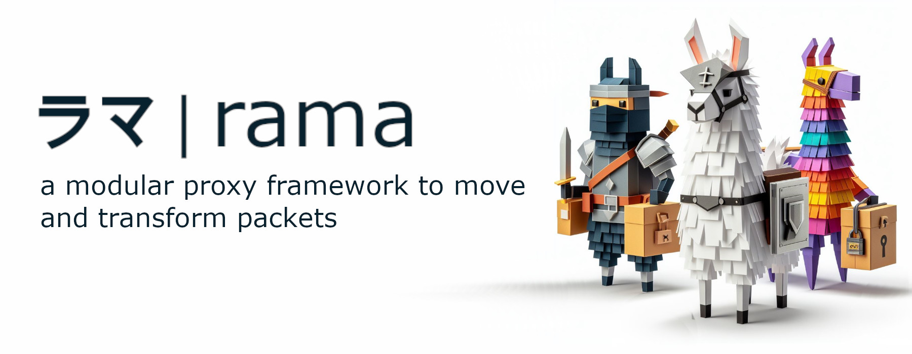

[![Crates.io][crates-badge]][crates-url]
[![Docs.rs][docs-badge]][docs-url]
[![MIT License][license-mit-badge]][license-mit-url]
[![Apache 2.0 License][license-apache-badge]][license-apache-url]
[![rust version][rust-version-badge]][rust-version-url]
[![Build Status][actions-badge]][actions-url]

[![Discord][discord-badge]][discord-url]
[![Buy Me A Coffee][bmac-badge]][bmac-url]
[![GitHub Sponsors][ghs-badge]][ghs-url]
[![Paypal Donation][paypal-badge]][paypal-url]

[crates-badge]: https://img.shields.io/crates/v/rama-json.svg
[crates-url]: https://crates.io/crates/rama-json
[docs-badge]: https://img.shields.io/docsrs/rama-json/latest
[docs-url]: https://docs.rs/rama-json/latest/rama_json/index.html
[license-mit-badge]: https://img.shields.io/badge/license-MIT-blue.svg
[license-mit-url]: https://github.com/plabayo/rama/blob/main/LICENSE-MIT
[license-apache-badge]: https://img.shields.io/badge/license-APACHE-blue.svg
[license-apache-url]: https://github.com/plabayo/rama/blob/main/LICENSE-APACHE
[rust-version-badge]: https://img.shields.io/badge/rustc-1.96+-blue?style=flat-square&logo=rust
[rust-version-url]: https://www.rust-lang.org
[actions-badge]: https://github.com/plabayo/rama/actions/workflows/CI-status.yml/badge.svg?branch=main
[actions-url]: https://github.com/plabayo/rama/actions/workflows/CI.yml

[discord-badge]: https://img.shields.io/badge/Discord-%235865F2.svg?style=for-the-badge&logo=discord&logoColor=white
[discord-url]: https://discord.gg/29EetaSYCD
[bmac-badge]: https://img.shields.io/badge/Buy%20Me%20a%20Coffee-ffdd00?style=for-the-badge&logo=buy-me-a-coffee&logoColor=black
[bmac-url]: https://www.buymeacoffee.com/plabayo
[ghs-badge]: https://img.shields.io/badge/sponsor-30363D?style=for-the-badge&logo=GitHub-Sponsors&logoColor=#EA4AAA
[ghs-url]: https://github.com/sponsors/plabayo
[paypal-badge]: https://img.shields.io/badge/paypal-contribution?style=for-the-badge&color=blue
[paypal-url]: https://www.paypal.com/donate/?hosted_button_id=P3KCGT2ACBVFE

🦙 rama® (ラマ) is a modular service framework for the 🦀 Rust language to move and transform your network packets.
The reasons behind the creation of rama can be read in [the "Why Rama" chapter](https://ramaproxy.org/book/why_rama).

## rama-json

Streaming JSON tools for rama, independent of HTTP.

- [`tokenizer`](src/tokenizer/mod.rs): a strict, incremental tokenizer. `Tokenizer::write`
  takes byte chunks and emits borrowed tokens, whitespace and punctuation included, so
  a pass-through sink reproduces the input exactly. Buffered input is capped at
  `DEFAULT_MAX_BUFFERED_BYTES` (8 MiB), configurable per tokenizer.
- [`path`](src/path/mod.rs): JSONPath ([RFC 9535](specifications/rfc9535.txt)) parsing
  (`JsonPath` implements `FromStr`) and a builder. Supported are the selectors that can
  be matched while streaming forward: member names, non-negative indexes and slices,
  wildcards, selector lists and descendant segments. Filters and negative or
  end-relative array selectors are rejected.
- [`select`](src/select.rs): streaming token selection by JSONPath.
- [`rewrite`](src/rewrite.rs): replace or remove scalar values and whole object or
  array subtrees while the rest of the document streams through (`JsonRewriter`,
  `rewrite_bytes`).
- [`capture`](src/capture.rs): capture small selected values whole, bounded by
  `max_capture_bytes`, while the rest of the input streams (`JsonCapturer`,
  `capture_bytes`).

Through the `rama` crate this is `rama::json`. The HTTP body middleware
`JsonRewriteLayer` and `JsonCaptureBody` in `rama-http` are built on it.

Crate used by the end-user `rama` crate and `rama` crate authors alike.

Learn more about `rama`:

- Github: <https://github.com/plabayo/rama>
- Book: <https://ramaproxy.org/book/>
