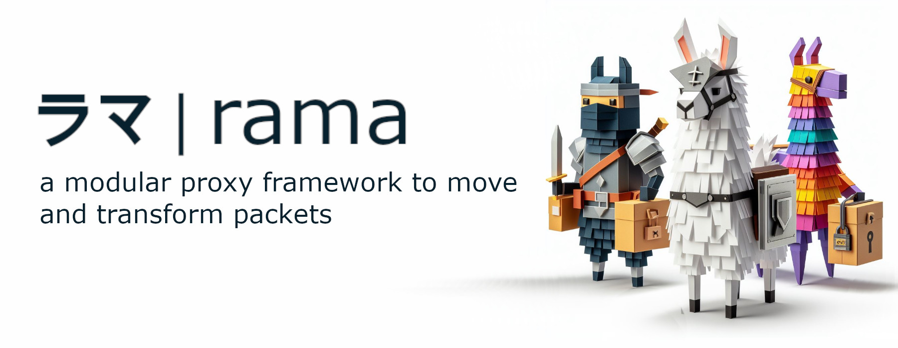

[![Crates.io][crates-badge]][crates-url]
[![Docs.rs][docs-badge]][docs-url]
[![MIT License][license-mit-badge]][license-mit-url]
[![Apache 2.0 License][license-apache-badge]][license-apache-url]
[![rust version][rust-version-badge]][rust-version-url]
[![Build Status][actions-badge]][actions-url]

[![Discord][discord-badge]][discord-url]
[![Buy Me A Coffee][bmac-badge]][bmac-url]
[![GitHub Sponsors][ghs-badge]][ghs-url]
[![Paypal Donation][paypal-badge]][paypal-url]

[crates-badge]: https://img.shields.io/crates/v/rama-tls-acme.svg
[crates-url]: https://crates.io/crates/rama-tls-acme
[docs-badge]: https://img.shields.io/docsrs/rama-tls-acme/latest
[docs-url]: https://docs.rs/rama-tls-acme/latest/rama_tls_acme/index.html
[license-mit-badge]: https://img.shields.io/badge/license-MIT-blue.svg
[license-mit-url]: https://github.com/plabayo/rama/blob/main/LICENSE-MIT
[license-apache-badge]: https://img.shields.io/badge/license-APACHE-blue.svg
[license-apache-url]: https://github.com/plabayo/rama/blob/main/LICENSE-APACHE
[rust-version-badge]: https://img.shields.io/badge/rustc-1.96+-blue?style=flat-square&logo=rust
[rust-version-url]: https://www.rust-lang.org
[actions-badge]: https://github.com/plabayo/rama/actions/workflows/CI-status.yml/badge.svg?branch=main
[actions-url]: https://github.com/plabayo/rama/actions/workflows/CI.yml

[discord-badge]: https://img.shields.io/badge/Discord-%235865F2.svg?style=for-the-badge&logo=discord&logoColor=white
[discord-url]: https://discord.gg/29EetaSYCD
[bmac-badge]: https://img.shields.io/badge/Buy%20Me%20a%20Coffee-ffdd00?style=for-the-badge&logo=buy-me-a-coffee&logoColor=black
[bmac-url]: https://www.buymeacoffee.com/plabayo
[ghs-badge]: https://img.shields.io/badge/sponsor-30363D?style=for-the-badge&logo=GitHub-Sponsors&logoColor=#EA4AAA
[ghs-url]: https://github.com/sponsors/plabayo
[paypal-badge]: https://img.shields.io/badge/paypal-contribution?style=for-the-badge&color=blue
[paypal-url]: https://www.paypal.com/donate/?hosted_button_id=P3KCGT2ACBVFE

🦙 rama® (ラマ) is a modular service framework for the 🦀 Rust language to move and transform your network packets.
The reasons behind the creation of rama can be read in [the "Why Rama" chapter](https://ramaproxy.org/book/why_rama).

## rama-tls-acme

ACME (RFC 8555) client and protocol types for rama.

1. Create an `AcmeClient` from a directory URL, or with `AcmeClient::new_for_provider`
   and an `AcmeProvider` (Let's Encrypt, ZeroSSL, Google Trust Services).
2. Create or load an `Account` with an `EcdsaKey`. Store the key
   (`EcdsaKey::pkcs8_der`) to load the same account again with `load_account`.
3. Create an `Order` with `Account::try_new_order`, serve the HTTP-01 or
   TLS-ALPN-01 challenge, then `notify_challenge_ready` and wait for the
   authorizations to finish.
4. `finalize` the order with a CSR and download the certificate chain.

The [`proto`](src/proto/) module has the ACME wire types for clients and servers.
Through the `rama` crate this is `rama::tls::acme`, enabled with the `acme` feature.
Examples: [`acme_http_challenge`](../examples/src/acme_http_challenge.rs),
[`acme_tls_challenge_using_rustls`](../examples/src/acme_tls_challenge_using_rustls.rs)
and [`acme_tls_challenge_using_boring`](../examples/src/acme_tls_challenge_using_boring.rs).

Crate used by the end-user `rama` crate.

Learn more about `rama`:

- Github: <https://github.com/plabayo/rama>
- Book: <https://ramaproxy.org/book/>
