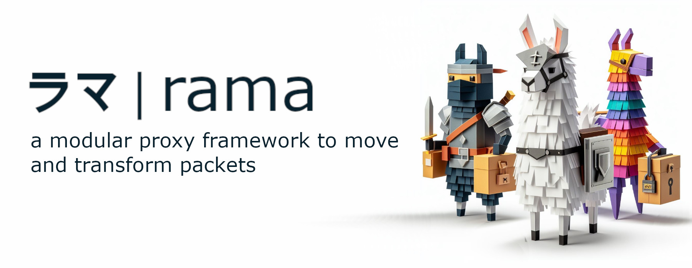

[![Crates.io][crates-badge]][crates-url]
[![Docs.rs][docs-badge]][docs-url]
[![MIT License][license-mit-badge]][license-mit-url]
[![Apache 2.0 License][license-apache-badge]][license-apache-url]
[![rust version][rust-version-badge]][rust-version-url]
[![Build Status][actions-badge]][actions-url]

[![Discord][discord-badge]][discord-url]
[![Buy Me A Coffee][bmac-badge]][bmac-url]
[![GitHub Sponsors][ghs-badge]][ghs-url]
[![Paypal Donation][paypal-badge]][paypal-url]

[crates-badge]: https://img.shields.io/crates/v/rama-ttrpc.svg
[crates-url]: https://crates.io/crates/rama-ttrpc
[docs-badge]: https://img.shields.io/docsrs/rama-ttrpc/latest
[docs-url]: https://docs.rs/rama-ttrpc/latest/rama_ttrpc/index.html
[license-mit-badge]: https://img.shields.io/badge/license-MIT-blue.svg
[license-mit-url]: https://github.com/plabayo/rama/blob/main/LICENSE-MIT
[license-apache-badge]: https://img.shields.io/badge/license-APACHE-blue.svg
[license-apache-url]: https://github.com/plabayo/rama/blob/main/LICENSE-APACHE
[rust-version-badge]: https://img.shields.io/badge/rustc-1.96+-blue?style=flat-square&logo=rust
[rust-version-url]: https://www.rust-lang.org
[actions-badge]: https://github.com/plabayo/rama/actions/workflows/CI-status.yml/badge.svg?branch=main
[actions-url]: https://github.com/plabayo/rama/actions/workflows/CI.yml

[discord-badge]: https://img.shields.io/badge/Discord-%235865F2.svg?style=for-the-badge&logo=discord&logoColor=white
[discord-url]: https://discord.gg/29EetaSYCD
[bmac-badge]: https://img.shields.io/badge/Buy%20Me%20a%20Coffee-ffdd00?style=for-the-badge&logo=buy-me-a-coffee&logoColor=black
[bmac-url]: https://www.buymeacoffee.com/plabayo
[ghs-badge]: https://img.shields.io/badge/sponsor-30363D?style=for-the-badge&logo=GitHub-Sponsors&logoColor=#EA4AAA
[ghs-url]: https://github.com/sponsors/plabayo
[paypal-badge]: https://img.shields.io/badge/paypal-contribution?style=for-the-badge&color=blue
[paypal-url]: https://www.paypal.com/donate/?hosted_button_id=P3KCGT2ACBVFE

🦙 rama® (ラマ) is a modular service framework for the 🦀 Rust language to move and transform your network packets.
The reasons behind the creation of rama can be read in [the "Why Rama" chapter](https://ramaproxy.org/book/why_rama).

## rama-ttrpc

[ttRPC](https://github.com/containerd/ttrpc) support for rama.

ttRPC is the lightweight RPC protocol used by container runtimes and their plugins,
such as containerd shims and the containerd Node Resource Interface (NRI). It uses
protobuf messages like gRPC, but replaces HTTP/2 with length-prefixed framing directly
on the byte stream.

The crate has no transport of its own. `Client::new` and `ServerConnection::new` take
an already-connected byte stream (any rama `Io`, such as a TCP or Unix socket stream, or
an in-memory `tokio::io::duplex` pair). `TtrpcServer` registers services and serves
each accepted connection; `TtrpcConnector` builds a client from a connector.

Service stubs are generated from `.proto` files by
[`rama-ttrpc-build`](../rama-ttrpc-build/) in a `build.rs` and included with
`rama_ttrpc::include_proto!`. The `protobuf` feature re-exports that crate as
`rama_ttrpc::build`.

Through the `rama` crate this is `rama::ttrpc`, enabled with the `ttrpc` feature.
See the [`ttrpc_server` example](../examples/src/ttrpc_server.rs) and the
[ttRPC section](https://ramaproxy.org/book/http/grpc.html#ttrpc-a-sibling-protocol)
of the book.

Crate used by the end-user `rama` crate and `rama` crate authors alike.

Learn more about `rama`:

- Github: <https://github.com/plabayo/rama>
- Book: <https://ramaproxy.org/book/>
